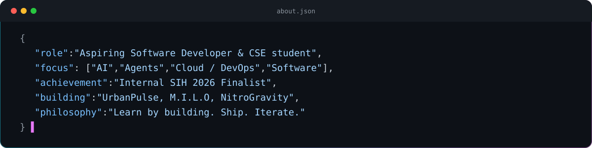

<div align="center">



<br>

<a href="https://gaushikkumarganesan.vercel.app/"></a>
<a href="https://www.linkedin.com/in/gaushikkumarganesan/"></a>
<a href="mailto:gaushikkumarganesan@gmail.com"></a>


</div>


## `~/about`




## `~/stack`

<div align="center">

<br>


</div>


## `~/projects`

<table>
<tr>
<td width="50%" valign="top">

### 🛣️ UrbanPulse
`AI` · `Computer Vision` · `SIH 2026`

AI-powered, multi-fleet road intelligence system. Camera-equipped vehicles detect, locate and track road defects, with a priority engine, warranty-based repair routing and multi-step verification.

[**Live demo ↗**](https://urban-pulse-sepia.vercel.app/)

</td>
<td width="50%" valign="top">

### 🧠 M.I.L.O
`Agentic AI` · `Android` · `Productivity`

An agentic AI companion that understands your priorities, manages daily tasks and turns goals into personalised plans through intelligent decisions and automation.

[**Source ↗**](https://github.com/Gaushik2008/CraftRoutine-ai.studio)

</td>
</tr>
<tr>
<td width="50%" valign="top">

### 🚀 NitroGravity
`3D` · `Simulation` · `NASA Space Apps`

A 3D space-mission design game: assemble a rocket, launch it, then read a debrief that names the exact cause of success or failure.

[**Source ↗**](https://github.com/Gaushik2008/nitrogravity)

</td>
<td width="50%" valign="top">

### 🎨 Portfolio Website
`HTML` · `CSS` · `JavaScript`

A hand-built, single-file portfolio with a colour-cycling hero, scroll-triggered animation, tilt cards and magnetic buttons.

[**Live site ↗**](https://gaushikkumarganesan.vercel.app/) · [**Source ↗**](https://github.com/Gaushik2008/portfolio-claude)

</td>
</tr>
<tr>
<td colspan="2" valign="top">

### 📊 Financial Leakage Intelligent System
`Software` · `Analytics`

A project focused on identifying potential financial leakages and supporting better financial oversight.

</td>
</tr>
</table>


## `~/certifications`

| Issuer | Certification |
|---|---|
| **IBM** | Getting Started with Artificial Intelligence |
| **Infosys Springboard** | Python Programming |
| **HackerRank** | Java (Basic) |
| **Unstop** | GitHub Workflow Mastery |


## `~/now`

```text
> learning   : cloud architecture on AWS, CI/CD with Jenkins, agent design
> building   : UrbanPulse, M.I.L.O and the next hackathon idea
> exploring  : AI agents that plan, decide and automate real workflows
> open to    : internships, collaborations and hackathon teams
```


## `~/activity`

<div align="center">


<br><br>


</div>

<br>

<div align="center">

**Let's build something together.**
[Portfolio](https://gaushikkumarganesan.vercel.app/) · [LinkedIn](https://www.linkedin.com/in/gaushikkumarganesan/) · [Email](mailto:gaushikkumarganesan@gmail.com)


</div>
