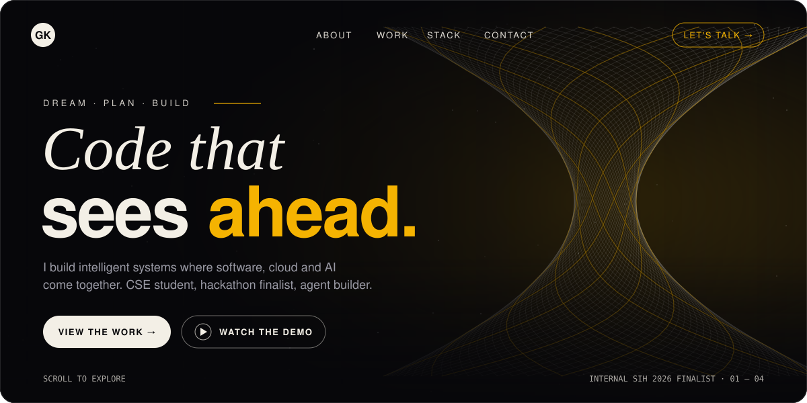
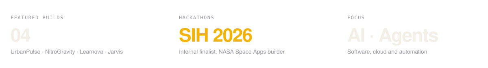
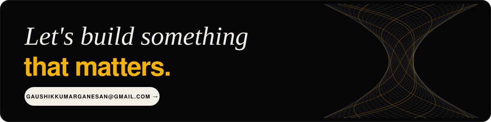

<div align="center">

<a href="https://gaushikkumarganesan.vercel.app/"></a>

<br>

<a href="https://gaushikkumarganesan.vercel.app/"></a>
<a href="https://www.linkedin.com/in/gaushikkumarganesan/"></a>
<a href="mailto:gaushikkumarganesan@gmail.com"></a>

<br><br>



</div>

<br>


I'm **Gaushik Kumar Ganesan**, a Computer Science Engineering student who turns ideas into working software. I'm drawn to the place where **software, cloud and AI** meet: agents that plan and decide, systems that see the real world, and products that make everyday work lighter.

I learn by building. Most of what I know came from shipping something imperfect, finding out why it broke, and making it better.

<br>


<table>
<tr>
<td width="50%"><a href="https://urban-pulse-sepia.vercel.app/"></a></td>
<td width="50%"><a href="https://github.com/Gaushik2008/nitrogravity"></a></td>
</tr>
<tr>
<td width="50%"><a href="https://github.com/Gaushik2008/edu-tutor"></a></td>
<td width="50%"><a href="https://github.com/Gaushik2008/Jarvis"></a></td>
</tr>
</table>

**Also built:** [M.I.L.O](https://github.com/Gaushik2008/CraftRoutine-ai.studio) (agentic AI life organiser) · [Portfolio site](https://github.com/Gaushik2008/portfolio-claude) (single-file, hand-animated) · Financial Leakage Intelligent System

<br>


<div align="center">

<br>


</div>

<br>


| Issuer | Certification |
|---|---|
| **IBM** | Getting Started with Artificial Intelligence |
| **Infosys Springboard** | Python Programming |
| **HackerRank** | Java (Basic) |
| **Unstop** | GitHub Workflow Mastery |

<br>


```text
learning   cloud on AWS, CI/CD with Jenkins, how agents plan and use memory
building   UrbanPulse, Jarvis, and the next hackathon idea
open to    internships, collaborations and hackathon teams
```

<br>

<div align="center">

<a href="mailto:gaushikkumarganesan@gmail.com"></a>

<br>


</div>
